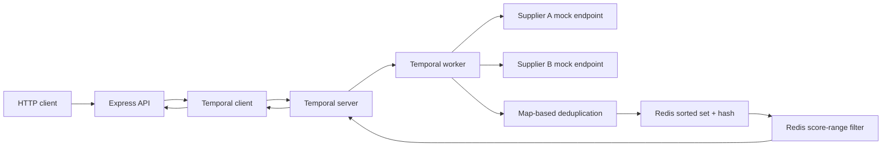

# Hotel Offer Orchestrator

A small TypeScript backend that fetches hotel offers from two mock suppliers, deduplicates them by hotel name, stores the final offers in Redis, and uses Temporal to orchestrate the workflow and price filtering.

## Technology stack

- Node.js 22.22 or later in the Node.js 22 release line
- TypeScript
- Express
- Temporal TypeScript SDK
- Redis sorted sets and hashes
- Docker Compose
- Node's built-in test runner

## Architecture



## Folder structure

```text
src/
├── server.ts
├── data/
│   ├── supplierA.ts
│   └── supplierB.ts
├── services/
│   ├── hotel.service.ts
│   └── redis.service.ts
└── temporal/
    ├── activities.ts
    ├── workflows.ts
    ├── worker.ts
    └── client.ts
tests/
├── hotel.service.test.ts
├── redis.service.test.ts
└── server.validation.test.ts
```

## How the workflow works

The Express API validates and normalizes the query, then starts `hotelWorkflow` on the `hotel-task-queue`. The workflow runs the Supplier A and Supplier B activities concurrently with Temporal retries. It passes both responses to `getBestHotelOffers()`, stores the deduplicated result in Redis, and calls a second activity that performs the price-range query in Redis.

HTTP and Redis access stay in activities. The workflow only coordinates activities and runs the deterministic Map-based comparison function.

## Deduplication

`getBestHotelOffers()` combines both supplier arrays in order and stores offers in a JavaScript `Map` keyed by the normalized hotel name. A later offer replaces an existing entry only when its price is lower. Equal prices keep the first offer.

## Redis storage and filtering

Each city has two Redis keys:

- A sorted set whose members are stable normalized hotel-name identifiers and whose scores are hotel prices.
- A hash containing the complete hotel offer JSON for each member.

Writing a city deletes its previous keys and repopulates both structures in one Redis transaction. This prevents stale results from remaining after a workflow execution. Both keys expire after five minutes. Price filtering uses Redis `ZRANGEBYSCORE` through the client `zRangeByScore()` API, then reads the matching objects from the hash.

## Run with Docker Compose

Docker Desktop is required.

```bash
docker compose config --quiet
docker compose up --build -d --wait
docker compose ps
docker compose logs worker --tail=50
```

The API, Redis, and Temporal have health checks. The worker waits for those services and should remain running with a `RUNNING` log entry on `hotel-task-queue`; it has no separate health check.

Services:

- API: `http://localhost:3000`
- Temporal frontend: `localhost:7233`
- Temporal Web UI: `http://localhost:8233`
- Redis: `localhost:6379`

The API and worker use Compose service names (`temporal`, `redis`, and `api`) for internal connections. The worker explicitly passes `TEMPORAL_ADDRESS` to its native Temporal connection. Host ports bind to `127.0.0.1` because the development services have no authentication. The Temporal image is pinned to the verified CLI 1.10.1 image digest (Server 1.32.2).

Redis data is stored in the `redis-data` volume, subject to the five-minute result TTL. Temporal uses in-memory development storage, so restarting its server clears workflow history.

Stop services with `docker compose down`. This preserves the Redis volume; `docker compose down -v` also deletes that data.

## Run locally without Docker

Install dependencies and start a local Temporal development server and Redis instance separately:

```bash
npm ci
temporal server start-dev
redis-server
```

In separate terminals:

```bash
npm run dev
npm run worker
```

The defaults are `PORT=3000`, `TEMPORAL_ADDRESS=localhost:7233`, `REDIS_URL=redis://localhost:6379`, and `API_URL=http://localhost:3000`. The npm scripts use exported environment variables; they do not automatically load `.env`.

For custom configuration, copy `.env.example` to `.env`, edit it, run `npm run build`, and launch these commands in separate terminals to explicitly load the file:

```bash
node --env-file=.env dist/server.js
node --env-file=.env dist/temporal/worker.js
```

Compose supplies its own container environment values in `docker-compose.yml`. Do not replace inter-container service hostnames with localhost. On Windows PowerShell, use `npm.cmd` if the execution policy blocks `npm.ps1`.

## API

### Supplier mocks

```http
GET /supplierA/hotels?city=delhi
GET /supplierB/hotels?city=delhi
```

### Final offers

```http
GET /api/hotels?city=delhi&minPrice=5000&maxPrice=6000
```

Parameters:

| Parameter | Required | Description |
| --- | --- | --- |
| `city` | Yes | Nonempty city name; normalized to lowercase. |
| `minPrice` | No | Finite, nonnegative number; defaults to `0`. |
| `maxPrice` | No | Finite, nonnegative number; defaults to an unbounded application range. |

The default maximum is `Number.MAX_SAFE_INTEGER`. Results are ordered by ascending price, and both price bounds are inclusive.

Example requests (quote URLs containing `&`):

```bash
curl "http://localhost:3000/supplierA/hotels?city=delhi"
curl "http://localhost:3000/supplierB/hotels?city=delhi"
curl "http://localhost:3000/api/hotels?city=delhi"
curl "http://localhost:3000/api/hotels?city=delhi&minPrice=5000&maxPrice=6000"
curl "http://localhost:3000/api/hotels"
curl "http://localhost:3000/api/hotels?city=delhi&minPrice=8000&maxPrice=5000"
```

The last two requests return HTTP 400. In Windows PowerShell, use `curl.exe` for these curl commands.

Example response for Delhi without price bounds:

```json
[
  { "name": "Holtin", "price": 5340, "supplier": "Supplier B", "commissionPct": 20 },
  { "name": "Radison", "price": 5900, "supplier": "Supplier A", "commissionPct": 13 },
  { "name": "The Oberoi", "price": 8000, "supplier": "Supplier B", "commissionPct": 18 },
  { "name": "Taj Palace", "price": 9000, "supplier": "Supplier A", "commissionPct": 15 }
]
```

For `minPrice=5000&maxPrice=6000`, the response contains Holtin at `5340` from Supplier B and Radison at `5900` from Supplier A.

Invalid city or price input returns HTTP 400. Temporal, supplier, or Redis failures return HTTP 500 from the final API route. Supplier and Redis activities are configured with up to three Temporal attempts and a ten-second start-to-close timeout.

## Tests

```bash
npm ci
npm run typecheck
npm run build
npm test
```

The comparison and API validation tests run without infrastructure. Redis tests run against `redis://localhost:6379` by default; run `docker compose up -d redis` first to include them. They cover replacement (including an empty result), city isolation, and inclusive price filtering. If Redis is unavailable, that integration test is skipped with an explicit reason; a fully verified run should have no skips.

For a custom Redis address, export `REDIS_URL` before running tests (`$env:REDIS_URL='redis://localhost:6379'` in PowerShell, or `export REDIS_URL=redis://localhost:6379` in Bash). Full Temporal integration requires all Compose services; use the API requests above and inspect executions at `http://localhost:8233`.

## Postman

Import `postman/Hotel-Orchestrator.postman_collection.json` into Postman. Its collection variable `baseUrl` defaults to `http://localhost:3000`. The 14 requests cover both suppliers, all hotels, single-sided/range/exact price bounds, unknown cities, missing/empty city, nonnumeric price, and an inverted range. Successful requests return HTTP 200; invalid inputs return HTTP 400. The range request returns Holtin at 5340 and Radison at 5900. The exact-price request returns only Holtin, confirming inclusive bounds. All three unknown-city requests return `[]`.

To verify Redis directly after a Delhi request:

```bash
docker compose exec -T redis redis-cli ZRANGE hotel-offers:delhi:prices 0 -1 WITHSCORES
docker compose exec -T redis redis-cli ZRANGEBYSCORE hotel-offers:delhi:prices 5000 6000
docker compose exec -T redis redis-cli HGETALL hotel-offers:delhi:details
```

The score-range command returns `holtin` and `radison`. Open `http://localhost:8233`, select the default namespace, and inspect a `hotelWorkflow` execution to see both supplier activities, Redis storage, Redis filtering, and completion.

## Design decisions and limitations

- One Express server file keeps the assignment easy to follow.
- The existing Map comparison function remains the source of truth for deduplication.
- Redis is used for durable, score-based filtering rather than filtering the full array in JavaScript.
- The Temporal development server and Compose setup are intended for local assignment use, not production deployment.
- Redis failures are surfaced to Temporal for retry and then reported by the API if all attempts fail.
- Redis connection attempts are bounded to five seconds and commands are not queued while disconnected; Temporal retains its three activity attempts. The worker closes both Temporal and Redis connections on shutdown.
